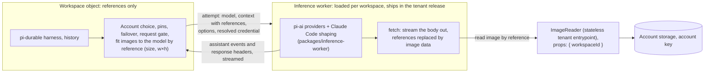

# Inference worker

Status: live (2026-10-29, `6214f49f`; platform `ce24c703`, `gitspace-inference-rebuild-20260913` deleted). Replaces the
platform-level inference Worker shipped in `e978eceb`. Checked live on PPVA (Bedrock): a prompt with an image answered
correctly.

## Goal

The workspace object never holds image bytes, in any form, and model requests never carry inline images. History
holds references (`gs-image:v1:<workspace>:<size>:<w>x<h>:<sha256>`). Every model request is serialized with references
and streamed out by an inference worker that writes each image in as the request leaves. The only image budget is the
model's own (count, bytes, dimensions); GitSpace adds no cap of its own.

## Shape

- **Where it runs:** the tenant's Worker Loader (`CODEMODE_LOADER`) loads it from modules in the tenant release, named
  `inference:<workspaceId>:<release>`. Each name is its own isolate, separate from the workspace object; a release gets
  fresh code. Nothing in the platform.
- **What stays in the workspace object:** pi-durable (agent loop, history, tools, compaction), the model catalog as
  data, account choice, credential pins, failover between accounts, the request gate, durable retries, and fitting
  images to the model's limits (references carry size and dimensions, so no bytes are needed).
- **What moves to the inference worker:** every chat request (`stream`, `streamSimple`), which builds and sends one
  request: pi-ai providers, Claude Code shaping and its billing attestation, and the vision fallback (a model request
  like any other).
- **What stays in the workspace object:** `generate_image` and `classify` (`generateImages`, `classify`). One call
  sends a prompt and at most a few images and gets one image or a short answer back, unlike a chat request carrying a
  whole context's images. `generate_image` loads stored input images (`images.load`) and stores its output as a
  reference.

## The attempt boundary

One model request attempt is one RPC call, `run(attempt)`, on the loaded worker's `Inference` entrypoint
(`runtime-core/src/inference/attempts.ts` defines the attempt, its events and their wire codec).

- **In:** model, context (references only), stream options, the resolved credential for this attempt (the workspace
  object keeps account choice; the worker never stores credentials).
- **Out:** a `ReadableStream` of serialized pi assistant events plus the response status and headers the workspace
  reads for rate limits and usage (`attempt.observe`, `onResponse`). The workspace turns it back into pi's event stream.
- **Cancel:** an `AbortSignal` cannot cross RPC. The workspace cancels the returned stream; the worker aborts the
  provider request when its stream is cancelled.
- **Errors** come back as pi's error events, as a provider failure does today.

## Images

- **Reader:** `ImageReader`, a stateless entrypoint of the tenant script, handed to the loaded worker as
  `ctx.exports.ImageReader({ props: { workspaceId } })` in its `env`. It serves a reference only if the reference names
  that workspace, from the account's own storage with the account key. The loaded worker cannot change `props`.
- **Streaming:** the provider serializes the request with references in place; the worker's `fetch` streams the body
  out, replacing each reference as it goes (`expandedRequest`). A Claude subscription request takes two passes: hash
  the expanded body (WASM XXH64), then send it with the attestation written in at its known length. Memory stays at a
  few chunks whatever the images add up to.
- **Every provider streams**, each through the path its pi-ai adapter allows (pi-ai 1.3.0):
  - Adapters that take our `fetch` and leave the base64 text alone (`anthropic-messages`, `openai-completions`,
    `openai-responses`, `azure-openai-responses`, `google-gemini-cli`, `mistral-conversations`, `openrouter-images`,
    `pi-messages`) send through it.
  - **Google** (`google-generative-ai`, and `google-vertex`, which GitSpace does not admit) refuses a custom `fetch` and
    sends through Google's SDK with the global one, the image data passed through as text. The worker wraps the global
    `fetch`: a body carrying references goes out through the same streaming transport. (Before this, Google requests
    failed in GitSpace outright: the models layer always passed a `fetch`.)
  - **Bedrock** (`bedrock-converse-stream`) decodes image data to bytes for the AWS SDK. The attempt swaps each
    reference for a valid-base64 stand-in that names it (`restoreStandIns`); the SDK base64-encodes the bytes back
    unchanged into its JSON body and sends it through the global `fetch`, where the wrapper turns the stand-ins back
    into references and streams the images in. pi-ai's Bedrock code, auth and reply parsing are used as they are.
- **Cursor** was removed (2026-10-29): its own provider, sign-in, token refresh and usage. Its protobuf requests carried
  images inside content-addressed history blobs, which the streaming transport cannot reach, and nobody used it.

## Ingest (second phase)

Images also enter a workspace inline today; each path changes to upload first and hand the workspace a reference
(with size and dimensions read where the bytes are):

| Path | Change |
| --- | --- |
| Images attached to a message | The browser uploads through the existing upload link; the prompt carries references |
| Machine tool results (screenshots, reading an image file) | The machine uploads to the drive and returns a reference |
| Browser relay captures | The relay or extension uploads and returns a reference |
| Codemode scripts that need image bytes | The script's isolate reads through the `ImageReader` |

Until then a workspace object briefly holds an incoming image while it stores it; that is bounded and was not what
reset workspaces.

## Probe results (2026-10-29)

From a Durable Object in a throwaway dispatch namespace, as the workspace object will call it:

- Worker Loader: wasm passed as the tenant's compiled module works; `ImageReader({ props })` in `env` works and sees
  its props (a plain loopback stub or an `RpcTarget` in `env` is refused); events stream back; cancelling the stream
  reaches the loaded worker; separate globals per name; object 70 MB + two loaded workers 70 MB each all succeeded;
  outbound fetch works; pi-ai with all 42 providers loads cold in 104 ms (our models layer bundle: 3.3 MB).
- Real requests (our `createVaultModels` in the loaded worker): Anthropic subscription with 2 images, "Red, blue" in
  1.8 s (images read in 436 ms); with 6.4 MB of images, correct in 2.4 s, attestation accepted; cancel mid-reply ends
  the stream; another workspace's reference is refused.
- Built module, live (2026-10-29), from a Durable Object loading the exact generated module with images read from
  R2 through a namespaced reader: Anthropic subscription with 2 images 200 "Red, Blue" in 3.9 s; Bedrock through the
  AWS SDK with stand-ins, 2 images 200 "Red, blue" in 2.7 s, and 6.4 MB of images 200 and correct in 5.3 s.
- Not run live: OpenAI, Google (no usable credential here).

## Test matrix before cutover

`packages/inference-worker/test/providers.test.ts` runs the built module in workerd with a fake reader and fake
upstreams, and checks the exact bytes each provider sends: Claude subscription (images written in, attestation over
the expanded body), OpenAI, Google, Gemini CLI, Bedrock through the AWS SDK; another workspace's
reference is refused before anything is sent. `runtime-core` tests the attempt codec, cancel and the stand-ins;
`account-worker` tests the real `ImageReader`.

## Order of work

1. **Platform ignores resource sources it does not know** (instead of refusing the release), so removing
   `inference-service` later cannot break restoring older releases.
2. **Inference worker**: the attempt boundary, the loaded worker with streaming expansion, `ImageReader`, Bedrock
   stand-ins, the global-`fetch` path for Google; Cursor removed.
3. **Cutover** in one release: the workspace uses the inference worker for every chat request; delete the platform
   `inference-service` source and `INFERENCE_SERVICE_NAME`, the deployed `gitspace-inference-rebuild-20260913` script
   (after the release), the image-bytes provider list (`BYTE_IMAGE_APIS`, `storedInline`) and `images.load` in the
   models layer.
4. **Ingest** paths (above), then delete the remaining workspace-side image handling. The inline caps stay only for
   inline images still in older histories.

Platform cleanup (separate, per `AGENTS.md`): remove the platform's default-frontend serving (accounts adopting a
default release copy its frontend into their own storage first), move native mirroring and machine-client resolution
into the account, move the Back to stable inference check into the tenant, and delete the old single-bundle deploy path.
